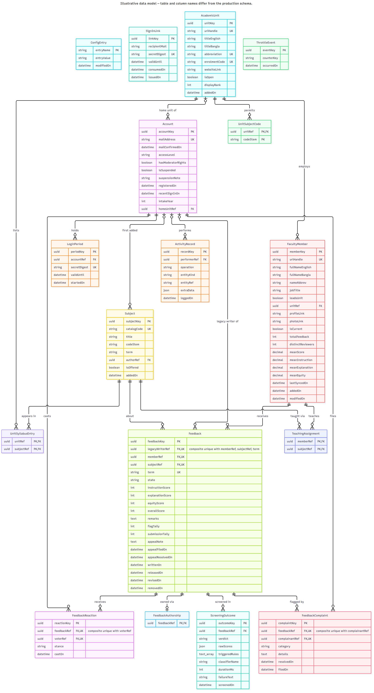

# RUET Faculty Review — Source-Available Transparency Repository

A student-led faculty review platform for Rajshahi University of Engineering & Technology (RUET). Students sign in using their institutional university Google account, submit structured feedback for faculty members who taught their courses, and read feedback written by fellow students.

- **Live Platform:** [ruetfacultyreview.site](https://www.ruetfacultyreview.site/)
- **Repository Nature:** **Source-Available Public Transparency Snapshot — Not Open Source.**
- **License:** Viewing only. See [LICENSE](LICENSE). No permission is granted to copy, modify, distribute, deploy, or host this software.

---

## Purpose of This Repository

This repository is published to provide public transparency into how the application operates, how student privacy is protected, and how reviewer data is handled.

### What You Can Verify
- **Reviewer Decoupling:** Public review endpoints, page templates, and client payloads do not expose reviewer identities, emails, or account IDs.
- **Sanitized Moderation:** The moderator queue DTO strips reviewer account information, ensuring moderators evaluate review content without author bias.
- **Architectural Boundary:** Review submission and management operations cross an explicit Privacy Core boundary designed to prevent direct account-to-review relational linkage.
- **Security Engineering:** Clean session management, role enforcement, security headers (CSP nonces), and rate limiting.

### What You Cannot Verify
- The proprietary implementation of the Privacy Core (including cryptographic ownership derivations and duplicate prevention algorithms) is withheld.
- Absolute resistance to privileged cloud infrastructure access or request-log correlation cannot be proven through application code alone. See [docs/THREAT_MODEL.md](docs/THREAT_MODEL.md).

> **Note:** This repository is a curated transparency snapshot. It is not a byte-for-byte mirror of the live production environment, nor is it a turnkey deployable package.

---

## Conceptual Data Model

> **Conceptual transparency model:** This diagram illustrates the high-level separation between accounts, public reviews, faculty/course data, and the private privacy subsystem. Entity and field names are intentionally generalized. Production identifiers, indexes, migrations, privacy-core storage structures, and cryptographic implementation details are intentionally omitted.

---

## Architecture & Transparency Documentation

For comprehensive details on privacy guarantees, threat boundaries, and scope:

- [docs/PRIVACY_MODEL.md](docs/PRIVACY_MODEL.md) — Detailed privacy architecture, safe claims, and verification boundaries.
- [docs/THREAT_MODEL.md](docs/THREAT_MODEL.md) — Adversary matrix, scope classification, and technical limitations.
- [docs/PUBLIC_RELEASE_SCOPE.md](docs/PUBLIC_RELEASE_SCOPE.md) — Complete manifest of included public source vs intentionally withheld components.
- [public-contracts/privacy-core.ts](public-contracts/privacy-core.ts) — Public interface contract for the Privacy Core subsystem.
- [public-contracts/persistence.ts](public-contracts/persistence.ts) — Conceptual persistence boundary.

---

## What Is Withheld & Why

Certain production components are intentionally omitted from this transparency release:

| Withheld Component | Rationale |
| :--- | :--- |
| **Privacy Core Implementation** | Protects proprietary cryptographic ownership logic and anonymous duplicate prevention from automated circumvention. |
| **Production Database Schema & Migrations** | Prevents targeted database schema exploitation and hides private privacy-specific table structures. |
| **Operational & Maintenance Tooling** | Internal backup scripts, scraping pipelines, database repair tools, and operational crons are private infrastructure assets. |
| **Deployment Secrets & Credentials** | Production API keys, database connection strings, and cryptographic salts/peppers are secret. |
| **Automated Moderation Prompts & Rule Lists** | Prevents malicious actors from engineering reviews to evade automated moderation. |

---

## Independent Affiliation Notice

This platform is an independent student transparency initiative. It is not affiliated with, endorsed by, or operated by Rajshahi University of Engineering & Technology (RUET). Reviews represent the individual opinions of student contributors.

---
Database Design (ERD)

The following Entity Relationship Diagram (ERD) illustrates the database structure of the RUET Faculty Review project.

## Website Preview

## Contact

For security inquiries or questions regarding this transparency release:
`ruetfacultyreview@gmail.com`
